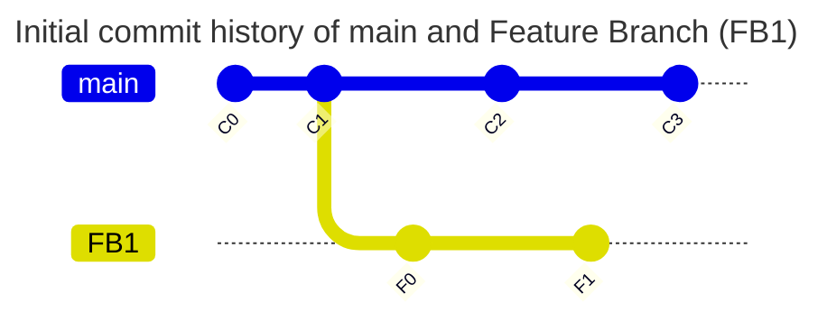
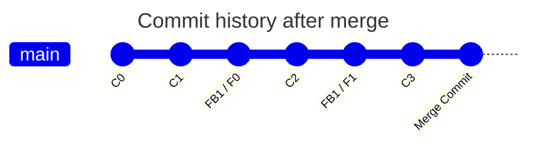
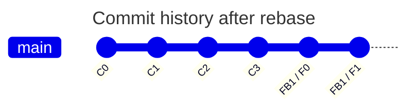
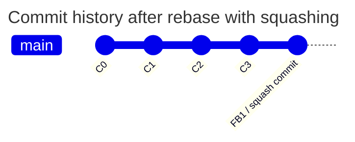

# Documenting git commands/notes 

## Set remote url with your email
This is useful when pushing code from your office laptop where office github account is different

```bash
git remote set-url origin https://atulthosar@github.com/simplyatul/front-end-tech.git
```
## Set name and email

```bash
 git config --global user.email "atulthosar@gmail.com"
 git config --global user.name "Atul Thosar"
```
Remove --global flag in case you want to set name/email for local repository only

```bash
git config --global code.editor "vim"
```
## Undo last commit (w/o removing the files)
```bash
git reset --soft HEAD~1
```

## Undo last commit (with removing the files)
```bash
git reset --hard HEAD~1
```

## Git User Stat
List the number of lines added, removed by a particular user

```bash
git log --author="Atul Thosar" --pretty=tformat: --numstat | awk '{ add += $1; subs += $2; loc += $1 - $2 } END { printf "added lines: %s removed lines: %s total lines: %s\n", add, subs, loc }'
```

## Tag operations
```bash
# Create tag
git tag v1.0

# List tags
git tag

# Push tag to remote
git push origin v1.0
```

## Merge Vs Rebase



### If merged performed then history will look like


### If rebase performed then history will look like

### If rebase performed with squashing then history will look like


## Pulling tags from parent repo into forked github repo
```bash
# Assuming you have cloned https://github.com/simplyatul/cilium/ which is created by forking https://github.com/cilium/cilium.git

cd cilium
git remote add upstream https://github.com/cilium/cilium.git
git fetch upstream refs/tags/1.17.0:refs/tags/1.17.0 --no-tags
```

## gitk remote branch
```bash
gitk origin/main &
```

## Comapre two branches
```bash
git difftool -t meld -d <origin/main> <origin/br-1>
```
-d => opens meld in directory comparison mode, showing all changed files side by side.

## Log only commit id and message
```bash
git log --oneline
```

## Merge w/o commit + squashing

```bash
git merge --squash origin/br-name
git commit -m "Your commit message here"
```

## Combine/Squash last few commits and force push to remote

```bash
git rebase -i HEAD~3 => combines last 3 commits
# This will open an editor. Change the second and third lines from pick to squash (or s), keeping the first one as pick:
# save and close
# Force push to the remote
git push --force-with-lease

# Use --force-with-lease instead of --force as a safety measure — it will fail if someone else has pushed to the branch in the meantime.
```